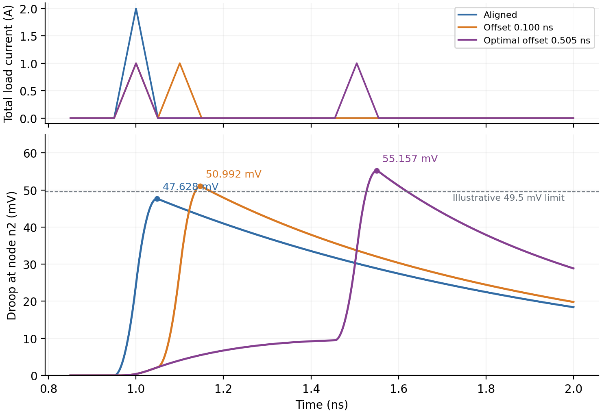

# When simultaneous switching underestimates RC-grid droop

**Validated R1 technical audit · 21 November 2026 · published v1.0.0**

This bounded study refutes a universal simultaneous-switching upper-bound claim in the pinned Vyges em-ir README. It does **not** claim a new general verification algorithm or a demonstrated silicon defect.

## Validated results

| Event offset | Closed form (mV) | Native CLI (mV) | ngspice (mV) |
|---|---:|---:|---:|
| 0 ns | 47.628046 | 47.583 | 47.628042 |
| 0.1 ns | 50.991913 | 50.858 | 50.991811 |
| 0.504591191 ns | 55.157458 | 54.465 | 55.157437 |

The unrestricted-phase optimum is **15.8088%** above simultaneous switching in this synthetic linear model. The original 0.1 ns example gives **7.0628%**. An illustrative 49.5 mV limit separates the cases; it is not an independently supplied sign-off criterion.

- 17 Python checks passed, including analytic, ODE, quadrature, scaling and negative controls.
- 45 pinned upstream tests passed.
- Native executable and ngspice 44.2 executed successfully; raw outputs are included.
- The proposed Rust regression passed (1 test); its patch applies cleanly.
- The source repository and [GitHub v1.0.0 release](https://github.com/RAckklot/em-ir-switching-phase-audit/releases/tag/v1.0.0) are public. The proposed upstream patch/issue has not been submitted or accepted; no peer-reviewed paper or Zenodo DOI is claimed.

Read **EM_IR_Validated_Report.pdf** or [the source report](docs/TECHNICAL_REPORT.md). Follow [reproduction instructions](docs/REPRODUCE_NATIVE.md).

## Scope

Two coupled nodes, fixed equal-charge triangular pulses, independently selectable event centers, zero initial droop, linear passive RC response. No timing legality from a real design, routed industrial grid, silicon measurements, electromigration validation, or commercial demand is established. The exact free-phase bound follows elementary superposition; no novelty is claimed for it.

Equal nominal energy means VDD times pulse charge, not necessarily equal actual load work at a varying node voltage. The default native timestep is 0.01 ns here; it underestimates the continuous optimum, while matching the Python backward-Euler reference.

The native process exits 0 even when `ir_met` is false. Inspect JSON budget flags.

## Artifact map

- `emir_audit/exact.py`: closed-form reference and unrestricted optimum.
- `emir_audit/model.py`: original independent numerical references.
- `scripts/verify_extended.py`: native, SPICE and mathematical comparisons.
- `scripts/make_extended_figures.py`: figures, phase sweep and convergence outputs.
- `examples/`: native three-case fixtures.
- `results/extended.json`: authoritative R1 numeric summary.
- `results/native/`, `results/spice/`: native outputs, decks, logs and raw waveforms.
- `results/environment.json`, `results/upstream-source.json`: tool versions and source provenance.
- `results/verification.json`: historical Python-only result; its native-not-run field describes that earlier run only.
- `docs/upstream-documentation-and-regression.patch`: proposed README correction and regression.
- `MANIFEST.sha256`: package-file digests.

Archived SPICE decks contain the original output path; the runner regenerates it for the current location. No upstream executable or full clone is redistributed.

## Licensing and assistance

Original reproduction code retains its MIT license. Upstream material is identified in the patch and `docs/UPSTREAM_LICENSE`. Analysis, implementation and writing used AI assistance; executed tests are not independent human review. Review and understand the work before presenting it as your research.

## Publication and citation

**The GitHub repository is public and [v1.0.0 was released on 21 November 2026](https://github.com/RAckklot/em-ir-switching-phase-audit/releases/tag/v1.0.0).** It includes a [citation file](CITATION.cff), [Zenodo metadata](.zenodo.json), [release notes](RELEASE_NOTES.md), and a [publication checklist](docs/PUBLISH_CHECKLIST.md). **No Zenodo DOI has been verified or linked here, and no upstream issue or patch has been accepted.**

**Zenodo archival:** check [Zenodo's GitHub integration](https://zenodo.org/account/settings/github/) for this repository and for a DOI associated with `v1.0.0`. If a DOI already exists, verify its record and add the exact DOI link here. If the Zenodo integration was enabled only *after* the `v1.0.0` release, it will not archive that earlier release automatically; enable the repository and create a new release (for example `v1.0.1`) to trigger archiving. Do not rerun the existing `v1.0.0` release script.

For the upstream correction, use the paste-ready [issue draft](docs/UPSTREAM_ISSUE_DRAFT.md) and [tested patch](docs/upstream-documentation-and-regression.patch).

The public GitHub author handle in the publication metadata is a **handle**, not a claim about institutional affiliation.
