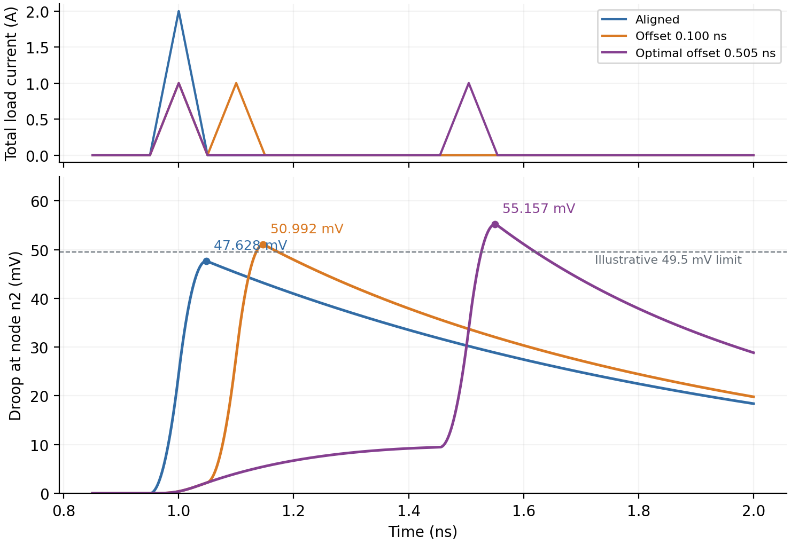
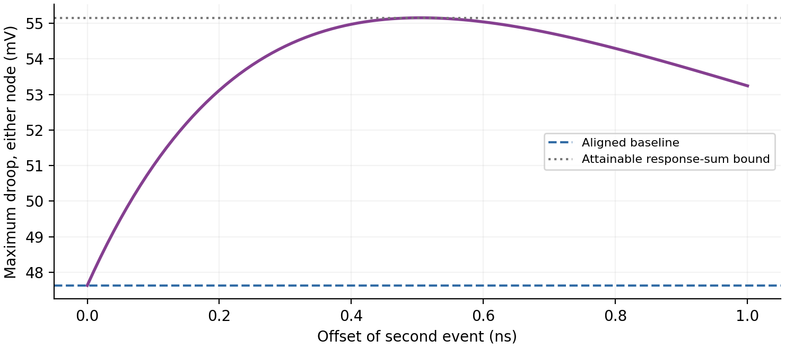

# When simultaneous switching
underestimates RC-grid droop

Validated reproduction and scope-limited mathematical analysis
Revision R1 • 21 November 2026

A two-node passive RC network disproves a universal simultaneous-switching upper-bound claim in the pinned Vyges em-ir README. This revision closes the original native-execution and independent-SPICE validation gaps, and derives the exact unrestricted-phase optimum for this model.

| Event-center separation | Closed form | Native CLI | ngspice |
| --- | --- | --- | --- |
| 0 ns (aligned) | 47.628046 mV | 47.583 mV | 47.628042 mV |
| 0.1 ns (original case) | 50.991913 mV | 50.858 mV | 50.991811 mV |
| 0.504591191 ns (optimum) | 55.157458 mV | 54.465 mV | 55.157437 mV |

The unrestricted-phase maximum is 15.8088% above the simultaneous value. At an illustrative 49.5 mV limit, native execution changes from PASS for aligned events to FAIL for both staggered cases. This limit is chosen to expose the decision difference; it is not an industrial requirement.

Figure 1. Equal-charge current pulses and the resulting node-2 droop. Voltage-response peaks can reinforce even when current peaks do not coincide.

Verdict: validated model-level counterexample and portfolio technical note. No new general verification algorithm, real-silicon failure, electromigration result, patent novelty, or commercial demand is established.

---

## 1  Model and the exact claim under test

The audited upstream is vyges-tools/em-ir, commit 9ad03f02054ab3c3ec87bc69a684dff2aaf7a8a9, package vyges-em-ir 0.1.56 [1]. Its README describes globally aligned switching as a strict upper bound. In src/extract.rs, generated instance events use the global job.switch_t_ns. The manual .pdn input already permits separate event centers. The numerical solver evaluates supplied events; it does not optimize their phases.

Circuit: an ideal 1.8 V supply feeds n1 and n2 through separate 1 Ω resistors; another 1 Ω resistor couples n1 to n2. Each node has 1 nF capacitance to ground. Both nodes begin at the supply voltage. A triangular sink-current pulse at each node has peak 1 A and total duration 0.1 ns. There is one pulse per source and no background load, inductance, voltage-dependent load, or package model.

Let u = (1.8 − v₁, 1.8 − v₂). With time measured numerically in ns, the normalized equations are:

du/dt + G u = i(t),     G = [[2, −1], [−1, 2]],     u(0) = 0.
iⱼ(t) = max(0, 1 − 2|t − cⱼ|/0.1) A.

The tested centers are (1, 1) ns, (1, 1.1) ns, and (1, 1.5045911912944) ns. Each pulse supplies 50 pC of charge. The upstream switch input expresses this as 90 pJ divided by nominal VDD = 1.8 V. This preserves nominal supply-referenced energy and current shape; it does not assert equality of actual load work ∫vⱼ(t)iⱼ(t)dt across phase choices.

The 1 A peak is an intentionally simple linear-model normalization, not a characterized standard cell. Linear scaling preserves the relative phase effect; tests also check a 1 mA version. Neither scaling establishes a physically routed design. The counterexample is sufficient to refute the stated unrestricted mathematical bound, but insufficient to estimate production-chip risk.

Why alignment fails: local and cross-node impulse responses peak at different delays. A later local event can coincide with the delayed response from the other node. Thus the maximum of total current and the maximum of a particular node’s voltage droop need not occur under the same timing assignment.

A DC bound obtained by holding every load at its peak is a different stimulus and is not refuted here. Likewise, logically or temporally constrained event assignments may exclude the constructed phases.

---

## 2  Exact free-phase characterization

Assume a stable linear network, zero initial perturbation, fixed single-pulse shapes, and independently translatable source times. Let rₖⱼ(s) be node k’s droop response to source j with center zero. Assume each response has an attained maximum mₖⱼ. Then:

uₖ(t; c) = Σⱼ rₖⱼ(t − cⱼ).
max over c,t of uₖ(t; c) = Σⱼ mₖⱼ.
max over k,c,t of uₖ(t; c) = maxₖ Σⱼ mₖⱼ.

Proof. Each summand is at most its individual maximum, proving the upper bound. Choose a maximizer sⱼ for every rₖⱼ. For any sufficiently late T, set cⱼ = T − sⱼ. All individual maxima then coincide at T, and pulses can start after time zero. This attains the bound. Maximizing over k gives the global result. Simultaneous centers attain the node-specific bound exactly when the corresponding argmax sets have a common point.

This is an elementary superposition/separability argument, not a claimed new theorem or scalable sign-off method. Timing windows, shared clock phases, logical dependencies, repeated pulses, aggregate-current constraints, and nonlinear loads can invalidate the attainment construction. With phase restrictions, the same sum remains an upper bound, but can be unattainable.

For this symmetric two-node network, the self and cross kernels are kself(t) = (e⁻ᵗ + e⁻³ᵗ)/2 and kcross(t) = (e⁻ᵗ − e⁻³ᵗ)/2 for t ≥ 0, and zero otherwise. They follow by diagonalizing G into modes of rates 1 and 3 ns⁻¹.

For pulse half-width h = 0.05 ns, let x = t + h, q = max(z,0), and Rλ(z) = (λq + exp(−λq) − 1)/λ². The exact modal response is yλ(t) = [Rλ(x) − 2Rλ(x−h) + Rλ(x−2h)]/h. The self response is (y₁+y₃)/2; the cross response is (y₁−y₃)/2. The implementation uses an algebraically equivalent tail expression to avoid cancellation.

The self-response maximum is 45.540963768 mV at lag a = 0.045548112825 ns. The cross-response maximum is 9.616493927 mV at lag b = 0.550139304119 ns. Choose c₂ − c₁ = b − a = 0.504591191294 ns. Both contributions peak at node 2 at approximately 1.550139304 ns, giving 55.157457695 mV.

Why these are global response maxima: during the rising half of the pulse, the self response increases. On its falling half, each modal derivative is [(2 − exp(−λh))exp(−λt) − 1]/(hλ), strictly decreasing; their average crosses zero once. After the pulse, the self response decreases. For the cross response, the kernel increases up to ln(3)/2 ns, longer than the entire 0.1 ns pulse, so the response rises throughout the pulse. Its tail is a difference of two exponentials and its derivative has exactly one zero, the maximum reported above.

These decimal values use floating-point root finding and evaluation, not interval-arithmetic certification. The global-optimum justification is the attainment proof, not a finite phase sweep.

---

## 3  Validation and numerical limits

The unmodified upstream release binary was built with cargo build --release --locked. Independent implementations comprise closed-form responses, Green-function quadrature, piecewise ODE integration, a Python backward-Euler reference, and ngspice 44.2. Native and Python backward Euler agree within the native JSON rounding precision (0.001 mV). Raw outputs, SPICE decks, exported waveforms, version information, and hashes are included.

| Validation | Observed outcome |
| --- | --- |
| Python mathematical/model checks | 17 passed |
| Pinned upstream test suite | 45 passed |
| Proposed upstream integration regression | 1 passed; patch applies cleanly |
| SPICE, maximum step 0.2 ps | All three cases within 0.00011 mV of closed form |
| ODE and quadrature | Within 0.000084 mV and 0.000000001 mV respectively |

Controls include negligible inter-node coupling (removing the phase advantage), common time shifts, linear current scaling, causality/positivity, and timestep refinement. Independent implementations increase confidence but are not independent human review. Native execution and SPICE validate this synthetic circuit, not a measured device.

The native timestep is max(minimum pulse duration/10, 0.001 ns), hence 0.01 ns here. The unrestricted optimum is not aligned to that grid. Native backward Euler reports 54.465 mV rather than the continuous 55.157458 mV. The following refinement is performed in the equivalent Python integrator; the native CLI exposes no timestep control.

| Step (ns) | Optimum-case peak (mV) | Error (µV) |
| --- | --- | --- |
| 0.01 | 54.465129 | 692.329 |
| 0.005 | 54.911176 | 246.281 |
| 0.001 | 55.108827 | 48.631 |
| 0.0001 | 55.152721 | 4.737 |

Sampled charge remains 50 pC per source at all reported steps. The discrepancy is not evidence of lost pulse charge. Integration and sampling resolution explain the observed convergence. This numerical issue is separate from the simultaneous-switching assumption: even the native method exhibits the original counterexample.

All three native invocations exit with status 0, including the two IR-budget failures. A reproduction must inspect JSON ir_met (and other relevant budget fields), not treat a successful process exit as an electrical pass. SPICE comparisons use high-precision exported waveform data, not the rounded .measure display.

---

## 4  What is established—and what is not

Figure 2. Relative-phase sweep with the analytically attained free-phase bound. The curve is illustrative; the proof does not rely on sweep resolution.

| Claim | Evidence / decision |
| --- | --- |
| Simultaneous events universally upper-bound this RC droop | False; explicit admissible manual-input counterexample, reproduced natively and in SPICE. |
| Original 0.1 ns offset is worst case | False; the unrestricted optimum is about 0.504591 ns. |
| Native solver is fundamentally incorrect | Not established. Its output agrees with its backward-Euler reference; timestep error is visible. |
| A production design is falsely signed off | Not established. No authentic routed grid, feasible switching trace, or real acceptance threshold is tested. |
| Original PhD-level algorithm or patentable advance | Not established. Superposition and phase-aware verification have substantial prior art. |
| Useful reproducibility / portfolio contribution | Supported: bounded claim, derivation, controls, executable fixtures, raw results, and proposed regression. |

Recommended correction: qualify the global timestamp as a simultaneous-switching stress scenario; document that it is not a universal event-timing bound. Retain existing per-event input support. The included patch changes the README wording and adds a minimal two-case Rust integration test. It is a proposal, has not been submitted, and does not add a new optimizer.

---

## 5  Prior art, publication, and value

Fawaz and Najm, ICCAD 2017 [2], study power-grid verification under transient current constraints and develop worst-case voltage-drop bounds using constrained optimization. This is direct evidence that general worst-case transient power-grid verification is established research. Our fixed-shape, independently shifted pulses are a much narrower setting, and no computational or precision advantage over that work is demonstrated.

Wen, Li, Yu and Wang, ICCAD 2024 [3], study peak power and dynamic IR-drop assessment via waveform augmenting. Their activity correlations and waveform transformations already address switching timing as a first-class verification concern. This two-node construction does not refute that paper’s measured results, nor establish a new phase-search research direction.

Novelty verdict: the present result supports a source-specific correction and a careful explanatory derivation. It is not enough for an ICCAD/DAC/DATE research-paper claim, a funded-PhD breakthrough claim, or a defensible patent claim. No exhaustive patent clearance or freedom-to-operate analysis was performed. Do not claim that no related patent exists.

Commercial verdict: no validated commercial opportunity. The potential beneficiary is a user or maintainer of this particular early-stage analysis tool; demand for a paid phase-verification product has not been demonstrated. There are no customer interviews, measured silicon savings, deployment measurements, purchase commitments, or revenue estimates. The immediate useful output is a reproducible defect-in-assumption report and regression test.

Portfolio wording: “Validated a counterexample to a simultaneous-switching upper-bound assumption in an open-source RC power-grid analyzer. Reproduced the result with its native Rust executable and ngspice, derived the restricted model’s exact free-phase optimum, and prepared a documentation correction and regression test.” This wording reflects completed work without implying external acceptance or individual authorship of every component.

Research gate: GO for publishing a transparent portfolio reproduction after personal review. NO-GO for presenting it as an original general verification technique or commercial product. A follow-on research claim would first need an authentic extracted network, independently justified timing constraints, and an advantage over published constrained-verification baselines.

One justified next test, only if those inputs become available: use an independently produced routed RC grid and a functionally feasible timing trace to compare aligned stimulus with constrained phase assignments, checking droop in SPICE against an externally specified limit. Stop if the phase change is illegal, the limit is invented, or an existing baseline already gives an equally useful answer. Do not build a new framework before this gate.

---

## 6  Reproduce and audit

From the extracted package root, install the listed Python packages (requirements-tested.txt records the versions used), then run the following. Commands require Python, a Rust toolchain, Git, and ngspice on the local machine. Full native builds need network access to pinned dependencies.

python -m pip install -r requirements-tested.txt
PYTHONPATH=. python -m pytest -q
git clone https://github.com/vyges-tools/em-ir.git ../emir-upstream
git -C ../emir-upstream checkout 9ad03f02054ab3c3ec87bc69a684dff2aaf7a8a9
(cd ../emir-upstream && cargo build --release --locked)
(cd ../emir-upstream && cargo test --locked)
PYTHONPATH=. python scripts/verify_extended.py \
  --ngspice /absolute/path/to/ngspice \
  --native ../emir-upstream/target/release/vyges-em-ir \
  --upstream ../emir-upstream
PYTHONPATH=. python scripts/make_extended_figures.py

The runner regenerates portable fixture content and local-path SPICE decks, asserts the comparison tolerances, and writes results/extended.json. Archived raw decks retain the execution machine’s output path; regenerate them with the runner before use elsewhere. results/verification.json is the earlier Python-only run, not the authority for this revision. See docs/REPRODUCE_NATIVE.md for the optional proposed-patch check.

Environment: Python 3.12.14; NumPy 2.3.5; SciPy 1.17.0; pytest 9.2.0; matplotlib 3.10.8; Rust 1.100.0; ngspice 44.2. Cargo.lock SHA-256: 3772fe477ac91eaeb4df7991eb450ba39a1e362fb75de7c44abad575edc95873. The exact binary hash, dependency revisions, command output and package metadata are retained in results/. No binary reproducibility across platforms is claimed.

Primary sources

[1] Vyges em-ir: pinned README, extraction and solver source.

https://github.com/vyges-tools/em-ir/tree/9ad03f02054ab3c3ec87bc69a684dff2aaf7a8a9

[2] M. Fawaz and F. N. Najm. Power Grid Verification Under Transient Constraints. ICCAD 2017. DOI: 10.1109/ICCAD.2017.8203831.

https://www.eecg.utoronto.ca/~najm/papers/iccad17-mohammad.pdf

[3] Wen et al. Peak Power and Dynamic IR-drop Assessment via Waveform Augmenting. ICCAD 2024. DOI: 10.1145/3676536.3676767.

https://www.cse.cuhk.edu.hk/~byu/papers/C235-ICCAD2024-IRDrop.pdf

[4] ngspice documentation and user manual.

https://ngspice.sourceforge.io/docs.html

Assistance disclosure: analysis, implementation and writing were developed with AI assistance. Executed checks are reported explicitly; no human peer review, upstream acceptance, or silicon validation is implied.
